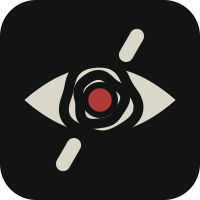
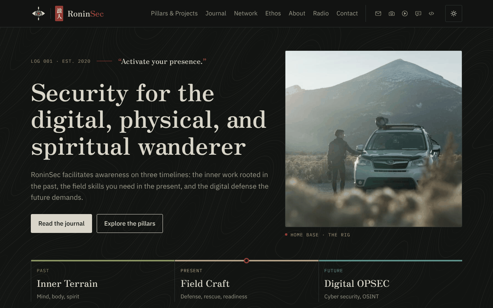
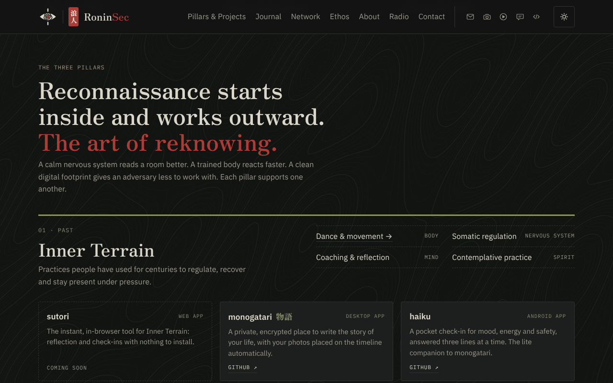

<p align="center"></p>

# RoninSec

**Security for the digital, physical, and spiritual wanderer.**

RoninSec is my umbrella brand for security and reconnaissance across three timelines: the inner work rooted in the past, the field skills the present calls for, and the digital defense the future demands. This repo is the source for its website.

**Live site:** https://r0n1n9.github.io/roninsec/



## Pillars & Projects

Inner Terrain has a web app, a desktop app and an Android app. Field Craft and Digital OPSEC are organized as offerings, some of them suites of several apps.

### Past · Inner Terrain
Mind, body, spirit: movement, somatic regulation, coaching and contemplative practice.

| Project | Platform | Links |
|---|---|---|
| sutori ストーリー | Web app | Coming soon |
| [monogatari](https://github.com/R0N1N9/monogatari) 物語 | Desktop | Private, encrypted life story writing with photos placed on the timeline automatically |
| [haiku](https://github.com/R0N1N9/haiku) 俳句 | Android | Three-line check-ins for mood, energy and safety; the lite companion to monogatari |

### Present · Field Craft
Defense, rescue, readiness: self defense, situational awareness, search and rescue and emergency readiness.

| Offering | What it is | Links |
|---|---|---|
| **Vigilance Suite** | Neighborhood situational-awareness console in three apps that join the same encrypted team: **Vigilance** (desktop), **Vigilante** (web and Field Agent phone app) and **Vigil** (Android) | [Open Vigilante](https://r0n1n9.github.io/vigilante/) · [Vigilance on GitHub](https://github.com/R0N1N9/vigilance) · Vigil: private repo |
| [**ISRStudio**](https://github.com/R0N1N9/isrstudio) | Offline drone ISR tools in three sections: **SAR** (find people in drone photos, export for ground teams), **Survey** (site security assessment) and **Stakeout** (activity patterns from a fixed camera) | [GitHub](https://github.com/R0N1N9/isrstudio) |

### Future · Digital OPSEC
Cyber security, OSINT, privacy and threat literacy.

| Offering | What it is | Links |
|---|---|---|
| **Daisho Suite** 大小 | One security suite in three editions: **Katana** 刀 (desktop), **Wakizashi** 脇差 (web) and **Tantō** 短刀 (Android, formerly karambit) | [Open Wakizashi](https://r0n1n9.github.io/wakizashi/) · [Wakizashi on GitHub](https://github.com/R0N1N9/wakizashi) · Katana and Tantō: links coming |
| **Karambit** | Testing suite: mobile penetration testing, for systems you own or are authorized to test | In development |
| [**NetWatch**](https://github.com/R0N1N9/netwatch) | Experimental playground for advanced security features. A network and spatial-sensing console: hosts and intrusion alerts on your network, who your devices talk to, and Wi-Fi presence sensing | [GitHub](https://github.com/R0N1N9/netwatch) |

## The Ronin network

Sibling brands that carry the RoninSec approach into specific passions. Each has its own repo, so each can take its own domain later.

| Brand | Focus | Site | Projects |
|---|---|---|---|
| [RoninRecon](https://github.com/R0N1N9/roninrecon) | Aerial photo & video, travel | https://r0n1n9.github.io/roninrecon/ | [IntelScraperStudio](https://github.com/R0N1N9/intelscraperstudio): imports, backs up and scores camera and drone footage. [ISRStudio](https://github.com/R0N1N9/isrstudio): offline drone tools for search and rescue and photography |
| [RoninRhythm](https://github.com/R0N1N9/roninrhythm) | Dance instruction, DJ & music production | https://r0n1n9.github.io/roninrhythm/ | [Sway](https://r0n1n9.github.io/roninrhythm/#sway): find partner-dance socials, classes and festivals anywhere (in development) |
| [RoninRxISK](https://github.com/R0N1N9/roninrxisk) | Psych med harm & PSSD research | https://r0n1n9.github.io/roninrxisk/ | [PSSD Atlas](https://claude.ai/artifact/EN98KYUks86xpNexsLm2dq) (web app): a living evidence map of PSSD research and drug-safety signals |

## Screenshots


*Pillars & Projects: each timeline with its practices and its web, desktop and Android apps.*

## Contact

- Email: roninsec42@proton.me
- Instagram: [@roninsec](https://www.instagram.com/roninsec/)
- YouTube: [@R0N1N_42](https://www.youtube.com/@R0N1N_42)
- X: [@R0N1N99](https://x.com/R0N1N99)

## Repo structure

| Path | What it is |
|---|---|
| `index.html` | The whole site: hero, pillars & projects, journal, network, ethos, about, contact |
| `images/` | Site photos, with location and camera metadata removed |
| `.nojekyll` | Tells GitHub Pages to serve the files as-is, with no build step |
| `docs/` | README assets: the logo (the site's favicon as an SVG file) and screenshots |

## Previewing locally

No build step. Serve the folder and open http://localhost:8000:

```bash
python3 -m http.server 8000
```
